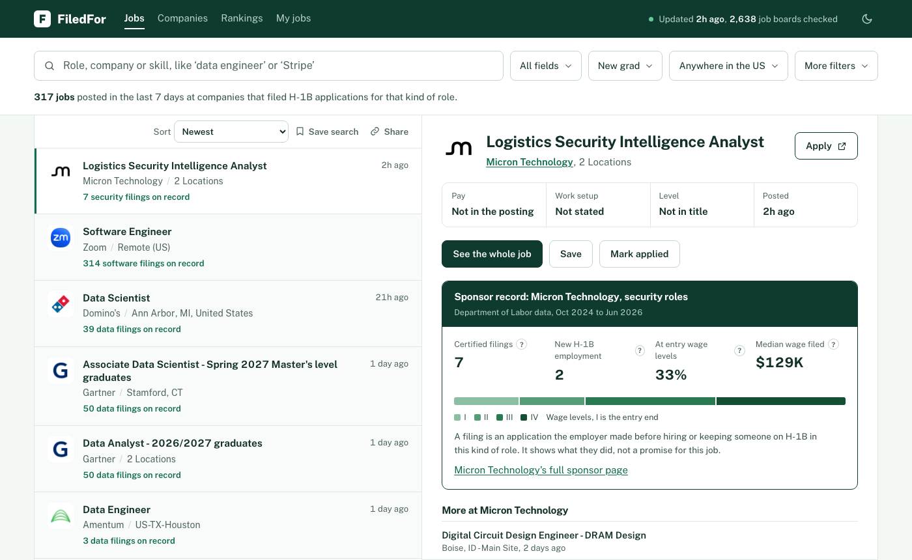

# FiledFor

[](https://github.com/jawaadjariwala/FiledFor/actions/workflows/ci.yml)
[](https://github.com/jawaadjariwala/FiledFor/actions/workflows/poll.yml)
[](LICENSE)

**Tech jobs, new grad to senior, at companies that have filed H-1B applications for that kind of role.**

**Use it: [filedfor.com](https://filedfor.com/)**. Free, no sign-up, refreshed about every 30 minutes.

[](https://filedfor.com/)

Most "visa-friendly" job lists tell you a company sponsors. FiledFor puts each job next to what the company actually filed with the Department of Labor for that kind of role: how many H-1B applications, how many were new hires, what share sat at the lower wage levels where new grads land, and the median wage. Postings that say citizens only, no sponsorship, or need a security clearance are left out, so every job listed is one you can apply to on a visa.

## Use it

- **Browse** the [site](https://filedfor.com/). Filter by field (Software, AI/ML, Data, Hardware & Embedded, IT & Cloud, Security, Product, Design), level (internship to senior), posting age, work setup, pay, metro area or state. Every search is a link you can share.
- **Search** for what you mean: "SWE new grad", "ml engineer" or "data engineer seattle" also find abbreviations, related roles, plurals and typos, with their own filters.
- **Read the whole job** on its own page: the full description, pay, work setup, years asked, when it was last checked, the company's filing record for that kind of role, more jobs at the company and similar jobs elsewhere. On a wide screen, a click previews the job beside the list first.
- **Look up a company**: [2,565 sponsor pages](https://filedfor.com/companies/) with filings by quarter, the job titles and cities filed for, wage levels and open roles (record only for 1,187 large filers like Amazon and Google, whose job boards FiledFor can't read yet), plus [rankings of every employer](https://filedfor.com/rankings/) and [pages by field and city](https://filedfor.com/jobs/).
- **Track your search** in My jobs: statuses from saved to offer, private notes, CSV export, saved searches that count new jobs, and hidden jobs or companies. All of it stays in your browser; there's no account.
- **Install it** on your phone's home screen like an app.
- **Follow an RSS feed** for new jobs: [all fields](https://filedfor.com/feeds/all.xml), [software](https://filedfor.com/feeds/swe.xml), [AI/ML](https://filedfor.com/feeds/ai.xml), [data](https://filedfor.com/feeds/data.xml). Works in any feed reader, and in Slack or Discord through an RSS bot.
- **Use the data.** [`jobs-recent.json`](https://filedfor.com/jobs-recent.json) (last 7 days) and [`jobs-older.json`](https://filedfor.com/jobs-older.json) (8 to 30 days) list every job; [`companies.json`](https://filedfor.com/companies.json) has each company's filing record per field, and [`health.json`](https://filedfor.com/health.json) shows the last run. The sponsor tables are in [`data/`](docs/data.md).

## How it works

```
DOL H-1B filings ──> sponsor tables (Parquet) ───────────────┐
                                                             ├──> poller ──> Postgres ──> site, JSON, RSS     
Greenhouse, Lever, Ashby, Workday, SmartRecruiters boards ───┘   (every 30 min, GitHub Actions)  (GitHub Pages)
```

1. **Sponsor data** (`lca.py`, `sponsors.py`). Every H-1B Labor Condition Application certified from October 2024 to June 2026, about a million rows, reduced to counts per employer, occupation and wage level. [Data notes](docs/data.md).
2. **Watchlist** (`watchlist.py`). About 2,600 company job boards, each matched to the employer's federal tax ID (FEIN) in the DOL data. Matching uses tiered rules and a reviewed queue rather than fuzzy scores, because a wrong match puts false evidence next to a job. [ADR-001](docs/decisions.md#adr-001-matching-job-feed-companies-to-dol-employers).
3. **Poller** (`poll.py`, `feeds.py`). Reads every board through its public JSON API, keeps US tech roles at every level, reads each new description for the years of experience asked, the pay, the work setup and language that rules out sponsorship, attaches the evidence, and stores what changed, with a cleaned copy of the description (`jd.py`). [ADR-002](docs/decisions.md#adr-002-the-poller). Workday boards are large and paged, so they're read newest first. [ADR-003](docs/decisions.md#adr-003-workday-and-smartrecruiters).
4. **Classifier** (`classify.py`). Rules that sort each title into one of eight fields and five levels, scored against hand-labelled titles and descriptions with `python -m filedfor.evaluate`. [Scores and known misses](docs/decisions.md#adr-004-all-tech-roles-all-levels).
5. **Publish** (`publish.py`, `pages*.py`). Writes the job board (`site/`), a page per job, per sponsor, per field and city and per ranking, the job and company JSON files, `health.json`, a sitemap index and one RSS feed per field, for GitHub Pages. [ADR-006](docs/decisions.md#adr-006-static-pages-for-search), [ADR-007](docs/decisions.md#adr-007-job-pages-and-the-record-style-redesign).

## Limits

- **Filings are history, not a promise.** A company that filed for software engineers before may not sponsor this particular role. Check the posting and ask the recruiter. Nothing here is legal advice.
- **Not every company is covered.** Only boards on the five systems above, found through the SimplifyJobs listings. Oracle and iCIMS are next.
- **Some companies file under a different legal name.** "No filings found" can mean the match missed, not that the company never sponsors.
- **The flags come from rules**, which get most jobs right and some wrong. They err toward leaving a job out.
- **Workday jobs close late.** New Workday jobs appear within 30 minutes, but a closed one can stay listed for up to about 12 hours.
- **Wage level is the prevailing wage level on the filing.** The FY2027 lottery weights by the level the offered wage reaches, which can be higher.

## Run it yourself

You need Python 3.13 and [uv](https://docs.astral.sh/uv/).

```sh
git clone https://github.com/jawaadjariwala/FiledFor.git && cd FiledFor
uv sync
uv run pytest
```

The poller needs a Postgres database (a free [Neon](https://neon.tech) project works):

```sh
echo "DATABASE_URL='postgresql://...'" > .env
uv run python -m filedfor.poll --no-alerts   # writes public/
python -m http.server -d public              # open http://localhost:8000
uv run python -m filedfor.poll --publish-only  # rebuild public/ from the database, e.g. after editing site/
```

The first run records every open job without alerting. Workday boards are read in full 60 at a time; `--workday-full 2000` reads all of them in the first run instead (about 10 minutes).

**To host your own copy:** fork the repo, add `DATABASE_URL` as an Actions secret, set Settings, Pages, Source to "GitHub Actions", and run the Poll workflow once. Add a `DISCORD_WEBHOOK` secret for Discord alerts on new matches.

**To rebuild the sponsor data:** download the LCA disclosure files from the [DOL performance data page](https://www.dol.gov/agencies/eta/foreign-labor/performance) into `data/raw/`, then:

```sh
uv run python -m filedfor.lca        # Excel to Parquet
uv run python -m filedfor.sponsors   # sponsor tables
uv run python -m filedfor.watchlist  # match boards to employers, probe each board
```

## Project layout

```
src/filedfor/
  lca.py, sponsors.py   DOL files to sponsor tables
  watchlist.py          find boards, match them to employers, probe them
  feeds.py              one adapter per job system
  classify.py           field, level, location and sponsorship rules
  evidence.py           filing record for a job's company and field
  diff.py, store.py     what changed since the last run, Postgres
  poll.py               one run, start to finish
  jd.py                 job descriptions as safe, tidy HTML
  publish.py, notify.py site, job and company JSON, RSS, Discord
  pages.py              shared layout for the static pages and the sitemap index
  pages_job.py, pages_company.py, pages_browse.py
                        job, sponsor, field and city, and ranking pages
  profiles.py, browse_stats.py
                        filing history per company and per field and city,
                        built locally from the row-level data
  logos.py              save company logos into site/logos (run by hand)
  evaluate.py           score the classifier against hand labels
site/                   the job board and the static pages' styles (HTML, CSS, JS; no
                        build step), fonts, logos, app manifest and service worker,
                        MiniSearch in site/vendor
data/                   sponsor tables, watchlist, hand-made decisions and labels
docs/                   design decisions, data notes, the link preview image source
tests/                  unit tests on saved, trimmed API responses
```

## Documentation

- [Design decisions](docs/decisions.md): matching, the poller, Workday, scope, portal features, search pages and the redesign, each with the options considered
- [Data notes](docs/data.md): sources, cleaning rules and quirks
- [Roadmap](ROADMAP.md)

## Contributing

Issues and pull requests are welcome, especially:

- a company FiledFor matched to the wrong employer, or missed (add it to `data/aliases.csv`)
- a job that's listed but shouldn't be, or the other way round ("Report a problem" on each job opens a pre-filled issue)
- adapters for more job systems

Run `uv run ruff check src tests`, `uv run ruff format src tests` and `uv run pytest` before opening a pull request. CI runs the same.

## Credits and license

H-1B data is public and comes from the U.S. Department of Labor. Company job boards were found through the [SimplifyJobs](https://github.com/SimplifyJobs) listings, which are used only to discover boards and are never republished. Company logos belong to their companies and are shown only to identify them.

Code under the [MIT License](LICENSE).
